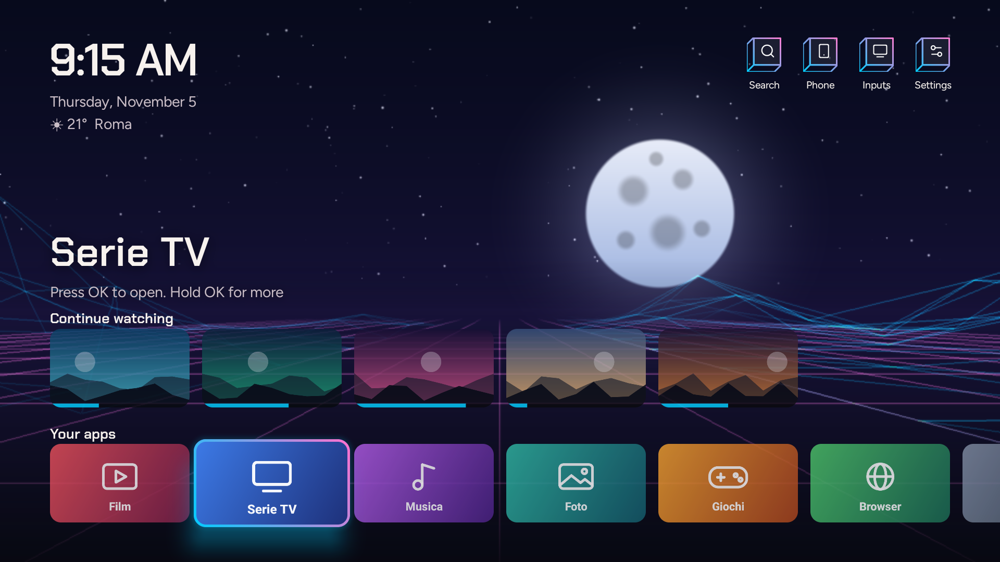
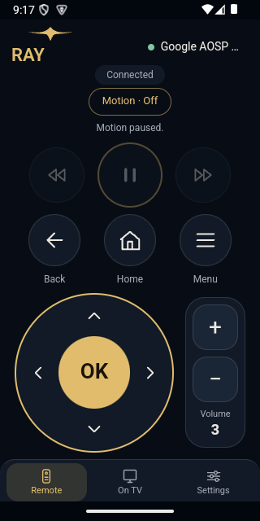
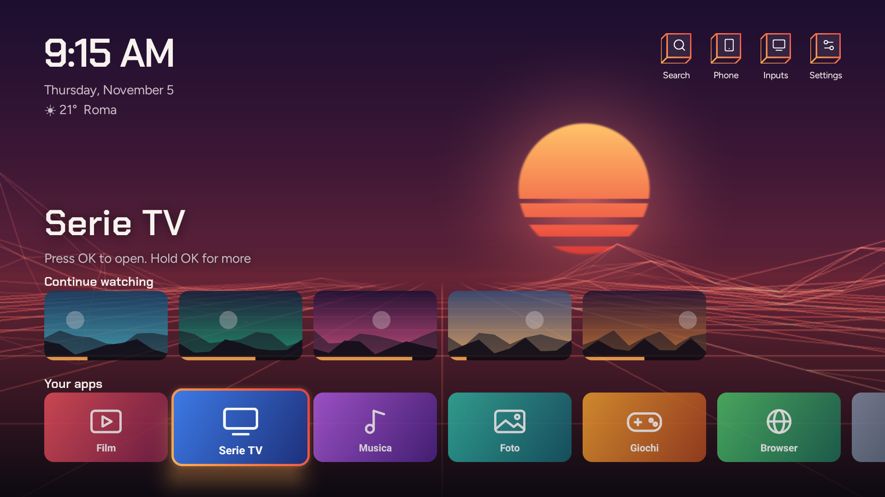
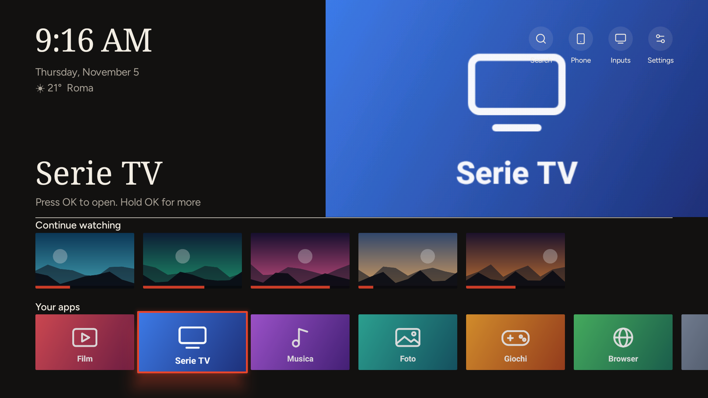
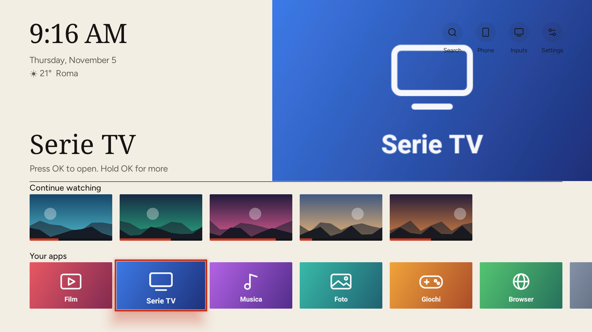
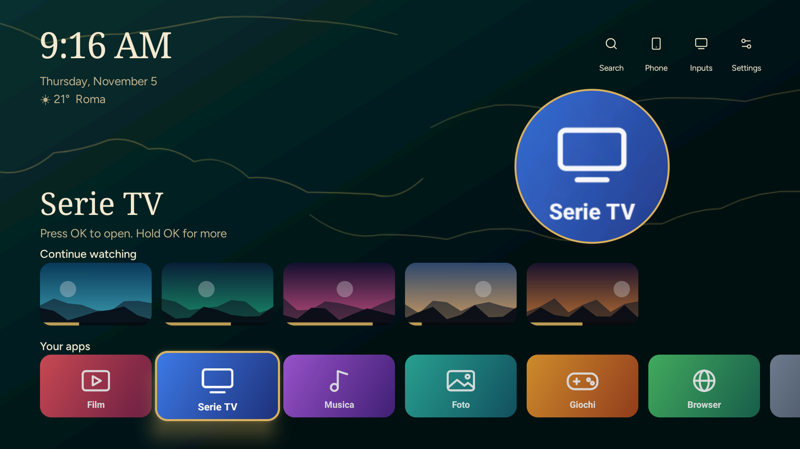
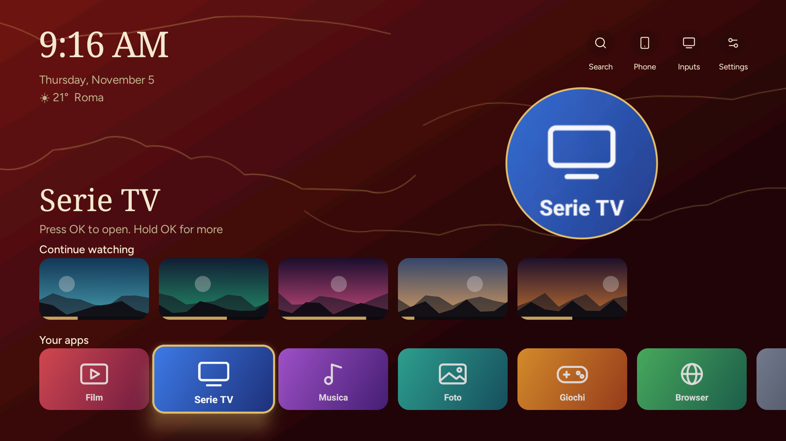
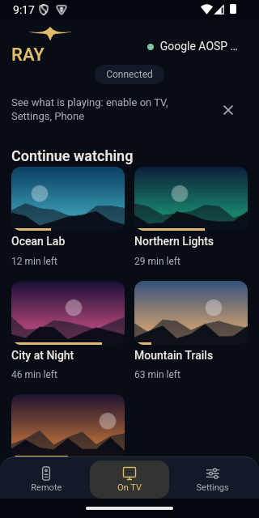
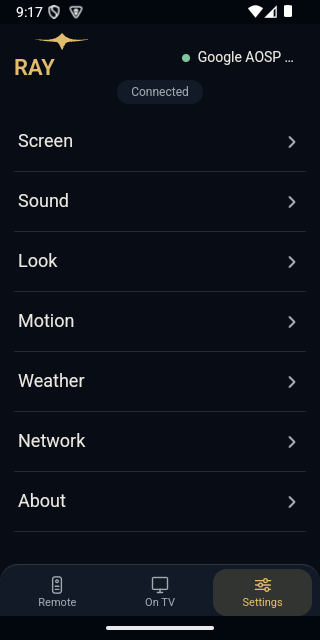

# RAY

<p align="center">
  
  
</p>

RAY is a lightweight, open-source **Android TV launcher** with a **phone companion**. It has a skin engine with
day/night looks, a phone remote with an air mouse, a screen filter with a schedule, and device audio effects.
It is plain Java with no Gradle, no analytics and no third-party SDKs. The network is used only on your local
network, except for an optional weather lookup that stays off until you consent.

- Android 8.0+ (API 26). The same APK is the launcher on a TV and the companion app on a phone.
- License: [MIT](LICENSE) - Privacy: [PRIVACY.md](PRIVACY.md)

## Features

- **Launcher**: the home has a *Continue watching* row (the "Watch Next" entries other Android TV apps publish, if you
  allow it) above your apps row, which ends with *All apps*, a grid of everything installed. Long-press an app to pin it.
- **Themes** (a theme is a skin): *Horizon*, *Magazine* and *Lacquer*, each with a **day** and a **night** variant that
  switch automatically at sunrise and sunset (or at fixed hours when weather is off). Horizon has an animated
  synthwave background with a sun by day and a moon by night. It runs only on capable devices (at least 1.8 GB of
  RAM, 4 cores, OpenGL ES 3) and turns itself off if it measures slow frames; Settings: Automatic / On / Off.
  A skin is a `skin.json` with optional wallpaper images and icons, so you can make your own:
  see [docs/SKIN_FORMAT.md](docs/SKIN_FORMAT.md) and [`tools/skin_pack.py`](tools/skin_pack.py).
- **Search**: one search for titles, typed or by voice where the device has speech recognition, then inside every app that accepts it.
- **Phone app** (optional, nothing on the TV asks for it: the D-pad remote alone is enough). Three tabs: *Remote*
  (D-pad, air mouse, volume), *On TV* (playback controls, continue watching and suggestions of the app on screen,
  app launcher) and *Settings*. Share a link from any phone app to open it on the TV. Pair by scanning the QR code on the
  TV (Settings > Pair a phone) or by typing the 4-digit code it shows; a browser works too, no app needed.
- **Air mouse**: steer a pointer on the TV with the motion of your phone (opt-in, adjustable sensitivity, recenter).
  The pointer can be drawn over other apps through Android's overlay permission or RAY's accessibility service.
- **Full access** (optional, off by default, Settings > Home): on devices whose own ADB is open, RAY uses it (on the
  device itself, see `app/src/dev/raylauncher/RayAdb.java`) to grant itself its permissions and to read the continue
  watching and suggestion lists of every app. Details in [PRIVACY.md](PRIVACY.md).
- **Screen filter and schedule**: a warm (red) filter and dimmer drawn above every app, with brightness and
  colour temperature, scenes, and a daily or weekly schedule with smooth transitions, applied by the TV itself.
- **Audio effects** (where the device supports them): equalizer, bass, virtualizer and loudness on the output mix.
- **Multiple devices**: the phone app finds TVs on the network (mDNS), keeps the ones you paired and can copy
  settings to several of them.
- **Optional weather** on the home screen, off until you accept a consent dialog (see Privacy).
- **Optional background music** on the home screen: off by default, a switch in Settings; three CC0 tracks from
  OpenGameArt (credits in [`app/assets/music/CREDITS.txt`](app/assets/music/CREDITS.txt)).
- English, Italian, German, French and Spanish. Other languages: add `app/assets/i18n/<language>.json`
  (English text to translation), see the existing files.

## Install

- **F-Droid**: coming soon.
- **GitHub releases**: download the APK from the [releases page](https://github.com/MadeinTaly/ray-launcher/releases)
  and install the same APK on the TV and on your phone (`adb install ray-launcher.apk` on the TV).

On the TV, open RAY and choose it as the home app in the system settings when Android asks. On the phone, open RAY,
pick *Connect a TV* and scan the QR code shown on the TV, or type its 4-digit code. The first start explains the optional permissions
(overlay, accessibility, usage access, notification access, Watch Next); each one is optional and only unlocks the
feature described next to it.

## Build

No Gradle and no Android SDK manager are needed, only a JDK (17), the Android build tools and an `android.jar`.

```sh
git clone --recurse-submodules https://github.com/MadeinTaly/ray-launcher.git
cd ray-launcher
```

The manifest targets API 35 and needs an `android.jar` of API 34 or newer, so the Debian `android-sdk-platform-23`
package is no longer enough: use the Android SDK.

With the Android SDK (Linux, macOS, or Windows with Git Bash):

```sh
export BUILD_TOOLS=$ANDROID_HOME/build-tools/35.0.0
export ANDROID_JAR=$ANDROID_HOME/platforms/android-35/android.jar
./build.sh            # signs with a local debug.keystore, created on first use -> ray-launcher.apk
SIGN=0 ./build.sh     # stops at the unsigned, aligned build/aligned.apk
```

The schedule editor library is the git submodule `vendor/dayrhythm`; if you cloned without `--recurse-submodules`
run `git submodule update --init`. `build.sh` copies its plain ES module sources into the APK.

The browser remote page is `web/remote.html`, styled with Tailwind CSS compiled at development time
(`web/build-css.sh`, needs Node). The generated `app/assets/remote.css` is committed, so building the APK needs
no Node. APKs signed with different keys cannot update each other: uninstall a release build before installing
your own.

### Tests

```sh
javac -cp "$ANDROID_JAR" -sourcepath app/src -d /tmp/ray-test test/RayWeatherTest.java test/RayAirMouseTest.java test/ScheduleMathTest.java test/WindowTest.java
java -cp /tmp/ray-test:"$ANDROID_JAR" dev.raylauncher.RayWeatherTest
java -cp /tmp/ray-test dev.raylauncher.RayAirMouseTest
java -cp /tmp/ray-test dev.raylauncher.WindowTest
java -cp /tmp/ray-test dev.raylauncher.ScheduleMathTest test/spec-cases.txt
```

(On Windows use `;` as the classpath separator.) `test/ray_smoke.py` is a live check against a TV (`RAY_HOST=<tv address> RAY_KEY=<pairing key>`);
`test/remote_ui.cjs` checks the browser remote offline with Playwright.

On dev builds (`DEV=1 ./build.sh`) `test/ray_flow.py`, `test/ray_settings.py`, `test/ray_search.py` and `test/ray_phone.py` drive a TV and a phone (emulators or real) and check the state through the debug channel; `ray_phone.py` also injects the sensors to test the air mouse; `test/ray_real.py` checks a real TV with its real apps.

Measured on a projector with 843 MB of RAM (Android 9): 1.4 s cold start, 0.2-0.6 s back to the home, 0% CPU at rest, about 80 MB of RAM with posters.

## Skins

A skin is a folder you can copy to the TV or install from the phone. The format, with an example and the day/night
variants, is documented in [docs/SKIN_FORMAT.md](docs/SKIN_FORMAT.md).
The realtime WebSocket protocol used by the phone is in [docs/PROTOCOL.md](docs/PROTOCOL.md).

## Control from scripts

The TV serves a small HTTP API on port 8766 protected by the pairing key (header `X-Key`):

```sh
curl -H "X-Key: $KEY" http://TV_IP:8766/api/info
curl -H "X-Key: $KEY" http://TV_IP:8766/api/state
curl -H "X-Key: $KEY" -H "Content-Type: application/json" -d '{"red":60,"bright":40}' http://TV_IP:8766/api/set
```

The screen filter can also be driven with `adb`:

```sh
adb shell am start-foreground-service -n dev.raylauncher/.DimService --ei red 60 --ei bright 40 --ei temp 1100
adb shell am start-foreground-service -n dev.raylauncher/.DimService --ez off true
```

Colour temperature goes from 1000 K (deep red) to 6500 K. The filter is an overlay: it darkens and tints the
picture but cannot lower the real backlight. Android 12+ limits the opacity of overlays that let touches through;
enable RAY in Settings > Accessibility for full darkness (and for the screensaver, which is drawn above
normal overlays). The accessibility service only lends its window to draw the overlay: it does not read the
screen or your input.

## AI assistants (MCP)

RAY can expose an [MCP](https://modelcontextprotocol.io) endpoint so an assistant such as Claude Code can drive
the TV: open apps, press keys, change the skin, the screen filter and the background music, read the state and a
debug log. It is off by default: turn it on in RAY > Settings > AI assistants (MCP) on the TV, which shows the
line to paste:

```sh
claude mcp add --transport http ray http://TV_IP:8766/mcp --header "X-Key: PAIRING_KEY"
```

It uses the pairing key like the rest of the API and plain HTTP on the local network, so anyone with the key on
your Wi-Fi can do what the phone remote can. Dev builds (`DEV=1 ./build.sh`) also have a debug channel: `adb shell dumpsys activity service dev.raylauncher/.DimService debug`. It does not exist in release builds.

## Screenshots

Demo mode with generated sample content: Horizon, Magazine and Lacquer, night and day; then the phone app.











## Privacy

RAY has no accounts, analytics or ads, and talks to your local network. Internet requests: the optional weather
lookup (after consent), the update check (GitHub installs only) and, with Full access on, poster images from the
addresses other apps publish. Details in [PRIVACY.md](PRIVACY.md).

## Updates

Installs from GitHub check `api.github.com` for a newer release when the app starts (at most every 6 hours) and offer
to install it; Android still asks for confirmation. Turn it off in the TV Settings (*Check for updates at start*).
*Beta updates* also takes pre-releases (on by default while the installed version is a beta). Going back to stable
waits for a newer stable release, since Android cannot downgrade an app. Installs from F-Droid never check: F-Droid
updates them.

## Third-party

Full notices, also inside the app: [`app/assets/THIRD_PARTY.txt`](app/assets/THIRD_PARTY.txt).

| Material | Copyright | License |
|---|---|---|
| Icons, [Lucide](https://lucide.dev) (partly from Feather) | Lucide Icons and Contributors; Cole Bemis | ISC, MIT |
| [QR Code generator library](https://www.nayuki.io/page/qr-code-generator-library), `app/src/io/nayuki/qrcodegen`, unmodified | Project Nayuki | MIT |
| [dayrhythm](https://github.com/MadeinTaly/dayrhythm), submodule `vendor/dayrhythm` | dayrhythm contributors | MIT |
| Font [Chakra Petch](https://github.com/m4rc1e/Chakra-Petch) | The Chakra Petch Project Authors | SIL OFL 1.1 |
| Font [Figtree](https://github.com/erikdkennedy/figtree) | The Figtree Project Authors | SIL OFL 1.1 |
| Font [Instrument Sans](https://github.com/Instrument/instrument-sans) | The Instrument Sans Project Authors | SIL OFL 1.1 |
| Music: "Heavenly Loop" and "Slow Stride" by isaiah658, "Calm Track" by pmiller, from OpenGameArt | public domain dedication | CC0 1.0 (credit not required, given with thanks) |

The RAY icon, the animated backgrounds and all screenshots are the project's own; screenshots show generated sample content.

## Support

If RAY is useful to you, you can support its development: https://linktr.ee/made_in_Taly

## Italiano

RAY e un launcher Android TV leggero e open source, con app per il telefono. Home con la riga *Continua a guardare* sopra le app e
la griglia *Tutte le app*; tre temi (Orizzonte, Rivista, Lacca) con aspetto giorno/notte (Orizzonte ha lo sfondo animato,
solo sui dispositivi capaci: almeno 1,8 GB di RAM, 4 core, GLES 3, e si spegne da solo se rallenta; Automatico/Acceso/Spento);
ricerca unica anche a voce; telefono facoltativo (la TV funziona anche col solo telecomando a frecce) con schede Telecomando,
Sul TV e Impostazioni, abbinamento con QR o codice a 4 cifre, mouse ad aria, condivisione di link verso la TV; accesso
completo facoltativo (Impostazioni > Home); filtro schermo con programmazione, effetti audio. Nessun account, nessun
tracciamento: la rete e usata nella tua rete locale; meteo e aggiornamenti sono descritti in [PRIVACY.md](PRIVACY.md).
Installazione, compilazione e formato delle skin sono descritti sopra e in [docs/SKIN_FORMAT.md](docs/SKIN_FORMAT.md).

## License

[MIT](LICENSE)
