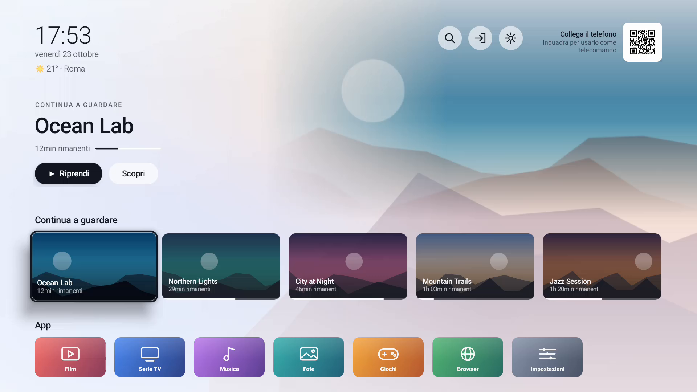
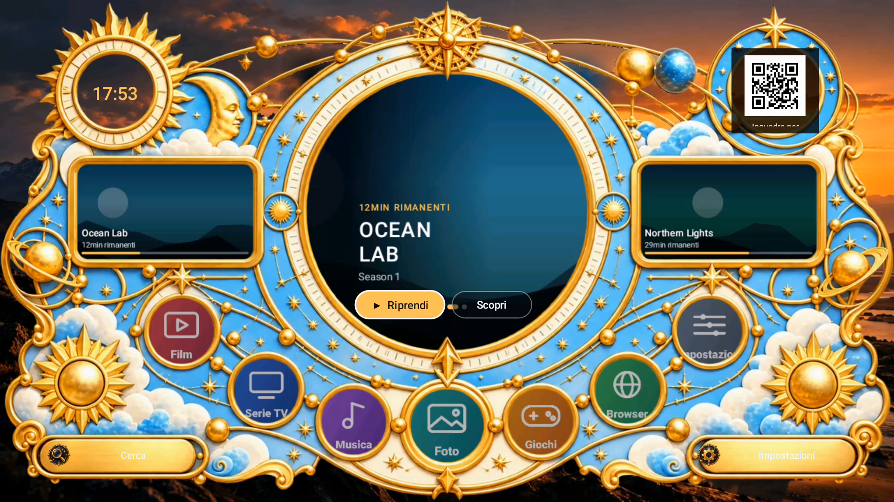
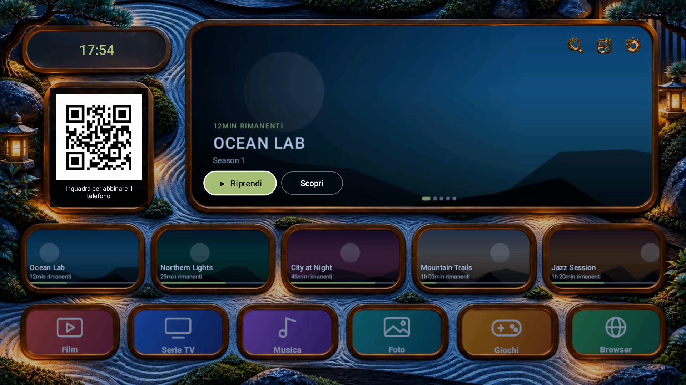

# RAY

RAY is a lightweight, open-source **Android TV launcher** with a **phone companion**. It has a skin engine with
day/night looks, a phone remote with an air mouse, a screen filter with a schedule, and device audio effects.
It is plain Java with no Gradle, no analytics and no third-party SDKs. The network is used only on your local
network, except for an optional weather lookup that stays off until you consent.

- Android 8.0+ (API 26). The same APK is the launcher on a TV and the companion app on a phone.
- License: [MIT](LICENSE) - Privacy: [PRIVACY.md](PRIVACY.md)

## Features

- **Launcher**: home screen with your installed apps (banners, names, icons), a full app catalog, and, if you allow
  it, the "Watch Next" entries published by other Android TV apps.
- **Skins**: the whole look of the home is a skin, a folder with a `skin.json` and a frame image. Several skins are
  bundled (frameless "stock" skins and framed artwork skins), each with a **day** and a **night** look that switch
  automatically at sunrise and sunset (or at fixed hours when weather is off). You can make your own:
  see [docs/SKIN_FORMAT.md](docs/SKIN_FORMAT.md) and the helper scripts in [`tools/`](tools).
- **Phone remote**: pair the phone by scanning the QR code on the TV (or from a browser, no app needed). D-pad, text
  search, app launcher, media controls for the app on screen, wallpaper and skin selection.
- **Air mouse**: steer a pointer on the TV with the motion of your phone (opt-in, adjustable sensitivity, recenter).
  The pointer can be drawn over other apps through Android's overlay permission or RAY's accessibility service.
- **Screen filter and schedule**: a warm (red) filter and dimmer drawn above every app, with brightness and
  colour temperature, scenes, and a daily or weekly schedule with smooth transitions, applied by the TV itself.
- **Audio effects** (where the device supports them): equalizer, bass, virtualizer and loudness on the output mix.
- **Multiple devices**: the phone app finds TVs on the network (mDNS), keeps the ones you paired and can copy
  settings to several of them.
- **Optional weather** on the home screen, off until you accept a consent dialog (see Privacy).
- English and Italian.

## Install

- **F-Droid**: coming soon.
- **GitHub releases**: download the APK from the [releases page](https://github.com/MadeinTaly/ray-launcher/releases)
  and install the same APK on the TV and on your phone (`adb install ray-launcher.apk` on the TV).

On the TV, open RAY and choose it as the home app in the system settings when Android asks. On the phone, open RAY,
pick *Connect a TV* and scan the QR code shown on the TV. The first start explains the optional permissions
(overlay, accessibility, usage access, notification access, Watch Next); each one is optional and only unlocks the
feature described next to it.

## Build

No Gradle and no Android SDK manager are needed, only a JDK (17), the Android build tools and an `android.jar`.

```sh
git clone --recurse-submodules https://github.com/MadeinTaly/ray-launcher.git
cd ray-launcher
```

Debian / Ubuntu:

```sh
sudo apt install openjdk-17-jdk-headless dalvik-exchange aapt zipalign apksigner android-sdk-platform-23
./build.sh
```

With the Android SDK (Linux, macOS, or Windows with Git Bash):

```sh
export BUILD_TOOLS=$ANDROID_HOME/build-tools/35.0.0
export ANDROID_JAR=$ANDROID_HOME/platforms/android-35/android.jar
./build.sh            # signs with a local debug.keystore, created on first use -> ray-launcher.apk
SIGN=0 ./build.sh     # stops at the unsigned, aligned build/aligned.apk
```

The schedule editor library is the git submodule `vendor/dayrhythm`; if you cloned without `--recurse-submodules`
run `git submodule update --init`. `build.sh` copies its plain ES module sources into the APK.

The browser remote page is `web/remote.html`, styled with Tailwind CSS compiled at development time
(`web/build-css.sh`, needs Node). The generated `app/assets/remote.css` is committed, so building the APK needs
no Node. APKs signed with different keys cannot update each other: uninstall a release build before installing
your own.

### Tests

```sh
javac -cp "$ANDROID_JAR" -sourcepath app/src -d /tmp/ray-test test/RayWeatherTest.java test/RayAirMouseTest.java test/ScheduleMathTest.java test/WindowTest.java
java -cp /tmp/ray-test:"$ANDROID_JAR" dev.raylauncher.RayWeatherTest
java -cp /tmp/ray-test dev.raylauncher.RayAirMouseTest
java -cp /tmp/ray-test dev.raylauncher.WindowTest
java -cp /tmp/ray-test dev.raylauncher.ScheduleMathTest test/spec-cases.txt
```

(On Windows use `;` as the classpath separator.) `test/ray_smoke.py` is a live check against a TV (`RAY_HOST=<tv address> RAY_KEY=<pairing key>`);
`test/remote_ui.cjs` checks the browser remote offline with Playwright.

## Skins

A skin is a folder you can copy to the TV or install from the phone. The format, with a full example, the day/night
variants and the measuring and packing tools, is documented in [docs/SKIN_FORMAT.md](docs/SKIN_FORMAT.md).
The realtime WebSocket protocol used by the phone is in [docs/PROTOCOL.md](docs/PROTOCOL.md).

## Control from scripts

The TV serves a small HTTP API on port 8766 protected by the pairing key (header `X-Key`):

```sh
curl -H "X-Key: $KEY" http://TV_IP:8766/api/info
curl -H "X-Key: $KEY" http://TV_IP:8766/api/state
curl -H "X-Key: $KEY" -H "Content-Type: application/json" -d '{"red":60,"bright":40}' http://TV_IP:8766/api/set
```

The screen filter can also be driven with `adb`:

```sh
adb shell am start-foreground-service -n dev.raylauncher/.DimService --ei red 60 --ei bright 40 --ei temp 1100
adb shell am start-foreground-service -n dev.raylauncher/.DimService --ez off true
```

Colour temperature goes from 1000 K (deep red) to 6500 K. The filter is an overlay: it darkens and tints the
picture but cannot lower the real backlight. Android 12+ limits the opacity of overlays that let touches through;
enable RAY in Settings > Accessibility for full darkness (and for the screensaver, which is drawn above
normal overlays). The accessibility service only lends its window to draw the overlay: it does not read the
screen or your input.

## Screenshots

Sample content (generated, no third-party artwork) shown with different skins.





## Screenshots

Sample content (generated, no third-party artwork) shown with different skins.


## Privacy

RAY has no accounts, analytics or ads, and talks only to your local network. The only internet request is the
optional weather lookup, after you accept a consent dialog. Details in [PRIVACY.md](PRIVACY.md).

## Third-party

- [QR Code generator library](https://www.nayuki.io/page/qr-code-generator-library) by Project Nayuki,
  MIT License (`app/src/io/nayuki/qrcodegen`, unmodified)
- [Tailwind CSS](https://tailwindcss.com), MIT License (compiled into `app/assets/remote.css`)
- [dayrhythm](https://github.com/MadeinTaly/dayrhythm), MIT License (git submodule `vendor/dayrhythm`, used
  unminified from its `src/`; the schedule editor of the phone page)
- Fonts: Chakra Petch and Inconsolata (SIL OFL 1.1) are not bundled in this release.
- The colour of the filter comes from Tanner Helland's black-body approximation.

## Support

If RAY is useful to you, you can support its development: https://linktr.ee/made_in_Taly

## Italiano

RAY e un launcher Android TV leggero e open source, con app per il telefono: skin con aspetto giorno/notte,
telecomando con mouse ad aria, filtro schermo con programmazione, effetti audio. Nessun account, nessun
tracciamento: la rete e usata solo nella tua rete locale; il meteo e facoltativo e parte solo dopo il tuo consenso.
Installazione, compilazione e formato delle skin sono descritti sopra e in [docs/SKIN_FORMAT.md](docs/SKIN_FORMAT.md).
Informativa: [PRIVACY.md](PRIVACY.md).

## License

[MIT](LICENSE)
